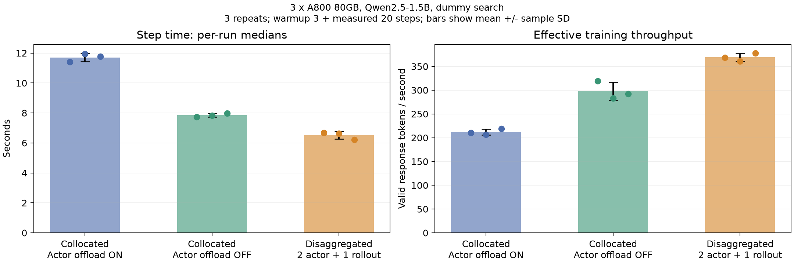
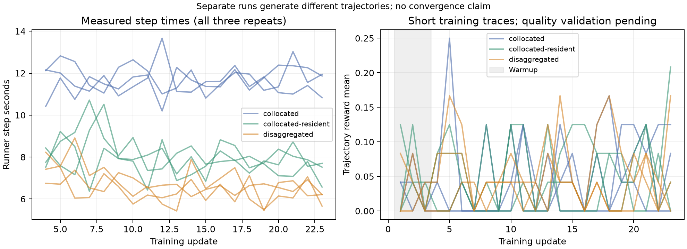

# Synchronous FSDP2 Search-R1 validation

This directory records the first-stage validation for [RLinf/RLinf#1812](https://github.com/RLinf/RLinf/pull/1812), addressing the synchronous part of [#1773](https://github.com/RLinf/RLinf/issues/1773). It is review material on a separate fork branch; it is not part of the upstream feature diff.

The measured source is `370bdaa76d6873dbbce6389bc6830814a4ef5535`, based on `main@3b35c5f344d46ab139ca9dd1ebd2780e03101160`. All nine benchmark runs used this source with an empty diff. Documentation-only changes after this commit do not change the tested production files. An AI assistant helped develop the code and collect this evidence.

## Deployment performance

One host with three A800 80GB PCIe GPUs, Qwen2.5-1.5B-Instruct, Search-R1, GRPO, FP16 computation/FP32 master parameters, FlashAttention 2 and Liger. Each update uses 12 questions x 2 trajectories. Sequence length 1024, prompt length 512, dynamic microbatch budget 1536 tokens, one minibatch, KL coefficient 0.001. Search uses the same dummy response in every configuration. Checkpointing and evaluation are disabled during measurement.

Each configuration has three repeats (seeds 1234, 1235, 1236), three warmup steps and twenty measured steps per repeat. The table reports mean +/- sample standard deviation across runs; the timing values are averages of each run's step median.

| Configuration | Actor / rollout allocation | Valid response tokens/s | Step median, seconds |
| --- | --- | --- | --- |
| Default collocated | 3 actor ranks / 3 rollout replicas on shared GPUs; Actor offload enabled | 212.18 +/- 6.24 | 11.708 +/- 0.283 |
| Resident collocated | Same allocation; Actor offload disabled | 298.16 +/- 19.04 | 7.846 +/- 0.122 |
| Disaggregated | Actor on GPUs 0-1; one rollout replica on GPU 2 | 369.01 +/- 8.41 | 6.516 +/- 0.252 |

Against resident collocated, disaggregation increases measured throughput by **23.76%** and reduces the average per-run step median by **16.96%**. Against default collocated, those changes are 73.91% and 44.35%. Disabling Actor offload alone is an existing option and improves the collocated result by 40.52%; that benefit is not a new code optimization.

| Run | Valid response tokens/s | Step P50, seconds | Step P95, seconds |
| --- | --- | --- | --- |
| [collocated-1234](runs/collocated-1234/summary.json) | 210.762 | 11.396 | 12.432 |
| [collocated-1235](runs/collocated-1235/summary.json) | 206.770 | 11.950 | 12.836 |
| [collocated-1236](runs/collocated-1236/summary.json) | 219.000 | 11.779 | 12.355 |
| [collocated-resident-1234](runs/collocated-resident-1234/summary.json) | 319.472 | 7.730 | 8.847 |
| [collocated-resident-1235](runs/collocated-resident-1235/summary.json) | 282.814 | 7.834 | 9.252 |
| [collocated-resident-1236](runs/collocated-resident-1236/summary.json) | 292.199 | 7.973 | 9.336 |
| [disaggregated-1234](runs/disaggregated-1234/summary.json) | 368.250 | 6.680 | 7.937 |
| [disaggregated-1235](runs/disaggregated-1235/summary.json) | 361.001 | 6.641 | 7.264 |
| [disaggregated-1236](runs/disaggregated-1236/summary.json) | 377.764 | 6.225 | 7.536 |

Throughput is the sum of `rollout/valid_response_tokens` divided by the sum of Runner `time/step` in logged step IDs 3..22. It excludes padding and tool tokens, but includes mask-valid tokens with zero advantage. Startup, metric logging and terminal teardown are excluded; process wall time is stored separately in the manifests. Twenty-four updates were requested because the terminal update is not logged; IDs 0..22 are retained. Stage timings may overlap and must not be summed as a critical path.

The default/disaggregated runs were interleaved as A1234/B1234/B1235/A1235/A1236/B1236. The resident-collocated runs were added afterwards and are not interleaved with them. This limits control of time drift. GPU 0/1 use PXB connectivity, while GPU 2 is across NUMA (SYS), with no NVLink. Allocation, actor DP size and rollout replica count change together. These are whole-deployment comparisons, not per-patch causal speedups or asynchronous overlap gains.

These are short training traces, not convergence or held-out quality results. All recorded loss, gradient norm, reward and step-time values are finite. Different deployments generate different trajectories. Three repeats do not establish statistical significance or universal gains.

Each `runs/` directory contains the composed config, actual launch argv and environment in the manifest, rollout seed audit, per-step CSV, GPU samples and summary. `gpu.csv` samples NVML every 500ms throughout the process; its peaks are not Torch allocated/reserved peaks or minimum hardware requirements. The source dataset/model hashes and collector SHA256 are in the manifests. Paths are from the experiment host and must be adapted when reproducing.

## Correctness

Real two-rank CUDA/NCCL FSDP2 tests compare a tiny Qwen with an unsharded reference: maximum gradient absolute error 2.98e-8, parameter-update error 3.73e-9 and resume error 0, with atol=1e-6/rtol=1e-5. The dynamic token-model path has maximum update error 7.45e-9. Actor tests: 24 passed, 5 skipped; skipped CPU FSDP2 cases require torch>=2.12, while the tested CUDA environment uses torch 2.11.0+cu130.

A full Qwen2.5-1.5B replay holds the initial model, multi-turn trajectories and Actor DP=2 fixed. With shared deterministic controls (`torch.use_deterministic_algorithms(True)`, `FLASH_ATTENTION_DETERMINISTIC=1`, `CUBLAS_WORKSPACE_CONFIG=:4096:8`), all 338 independent parameter tensors and gradients, logprobs and training metrics match exactly. The checks verify that the actual FlashAttention backward uses deterministic mode. Performance runs do not enable these controls.

The original default-backward comparison failed the predeclared thresholds. Repeating the same collocated layout also failed, consistent with the default FlashAttention backward being nondeterministic. Both failures are retained (`candidate-results.json`, `repeat-collocated-results.json`); the subsequent controlled replay does not relax the thresholds in `protocol.json`. Deterministic results are in `deterministic-*-results.json`.

Separate three-GPU functional runs cover six nonzero GRPO updates, six cross-GPU synchronizations with all 339 HF-named entries equal after loading into SGLang, tool masks, checkpoint at update 3 and functional resume to update 5, collocated Search-R1 and the existing dedicated-inference pipeline. The 339 state-dict entries include a tied alias; the replay checks 338 independent trainable tensors. Functional resume does not establish exact sampling or GradScaler replay.

## HTTP retrieval integration

`http-retrieval-results.json` records a separate three-update run with `dummy_mode=False`, a real CPU BM25 HTTP endpoint and 640 HotpotQA paragraphs. It produced 48 trajectories, 39 training HTTP queries, 36 two-turn trajectories and 6012 retrieved-tool tokens excluded from loss. Three gradient norms were finite and nonzero. The fixture is drawn from validation contexts and used for training; it is not a held-out accuracy result, full-Wikipedia retriever test or performance benchmark. Raw source paragraphs are not included here.

## Exit and remaining work

Training and the test HTTP service exited; all GPU memory returned to zero. Eighteen CUDA metadata files left by collocated Actor processes were individually matched to dead producer PIDs and manually removed; this is not an automatic-cleanup claim. The exact audit and final process/shared-memory state are retained.

Asynchronous scheduling, policy-version/staleness support, full-Wikipedia retrieval and long-run quality validation remain separate work. CI workflow additions are prepared locally but were not pushed because the publishing credential lacks workflow scope. Manual tests do not imply upstream CI passed.

The full local learning guide and experiment logs remain available to the submitter under `/home/rlinf-fsdp-local-lab/`. This public snapshot includes the small measurements and curves needed to assess the PR without uploading models, checkpoints or datasets.
